 

Full-stack web developer and B.E. Information Technology student who designs, builds and ships complete products. I work across the stack, from interactive React and JavaScript frontends to Python and SQL backends with REST APIs, and I focus on turning ideas into polished, usable software.

  
  
  

  

  
  

  
  
  

